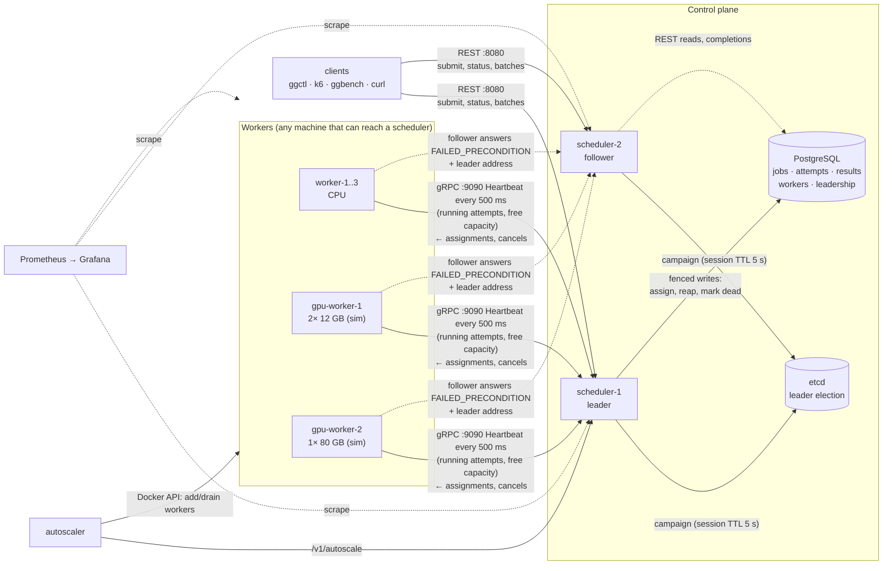

# GopherGrid

[homelab](https://github.com/zakiscoding/homelab) (docs hub) · [homelab-services](https://github.com/zakiscoding/homelab-services) · [homelab-gpu](https://github.com/zakiscoding/homelab-gpu) · [gpu-systems-lab](https://github.com/zakiscoding/gpu-systems-lab) · **gophergrid**

**A distributed compute scheduler in Go.** Clients submit jobs over REST. A leader scheduler,
elected in etcd, places them on workers by CPU, memory and GPU capacity, and workers run them
under leases they renew with gRPC heartbeats. When a worker or the leader dies, its jobs are
retried elsewhere, and every job still records exactly one result.

     

## Headline numbers

Measured on one laptop (i3-1215U, Docker Desktop on WSL2): 2 schedulers, 5 workers, all in
Docker, then on the homelab (iMac, laptop and GPU PC over Tailscale). Each number links to the JSON or test that produced it. Details: [docs/RESULTS.md](docs/RESULTS.md).

| What | Result |
|---|---|
| Kill a worker mid-run (100 image jobs) | Detected and its jobs reassigned **~2 s** later (3 s heartbeat timeout); 100/100 jobs, **0 duplicate results** |
| Kill the leader scheduler (600 jobs) | New leader in **3.9–4.9 s**, first assignment ~5 s after the kill; **0 duplicates**, no worker wrongly declared dead |
| Freeze a worker (`docker pause`), thaw it after its jobs moved | **0 results** recorded from its stale attempts |
| Random worker SIGKILLs under load (3,000 jobs) | **−7%** throughput vs. a no-kill control, 8 jobs retried, **0 duplicates** |
| Scheduler throughput, zero-length jobs | **276 → 1,269 jobs/s** after three measured fixes ([below](#performance-work)) |
| Queue latency, 5k-job burst | p50 **5.6 s → 27 ms** (eager worker sync + heartbeat long polling) |
| REST submit, k6 at 500 req/s for 30 s | 497 req/s, p95 **43 ms**, 0 errors; all 14,978 jobs ran exactly once |
| Batch submit | **28,083 jobs/s** (one `INSERT … SELECT FROM unnest`) |
| Inference fan-out, 2,048 prompts → 32 GPU shards | Spread over all 3 simulated GPUs, **no GPU ever double-booked** (checked per attempt) |
| **Homelab, 3 machines over Tailscale** ([details](docs/homelab.md)) | Leader killed on the iMac → laptop scheduler took over in **4.5 s**, 0 duplicates; real RTX 5070 job at 41.4 TFLOPS fp16 next to live vLLM; 1,620 jobs/s |
| Autoscaler, 1,500-job burst | +2 workers in 1.8 s, peak +4, back to 0 within 9 s of the queue draining |

## Architecture



1. **Submit.** Any scheduler accepts `POST /v1/jobs` or `/v1/jobs/batch` and writes `queued`
   rows. An `Idempotency-Key` makes a retried submit return the original job.
2. **Assign.** Only the leader assigns. Every 50 ms it takes a batch of queued jobs (priority,
   then age), places them greedily ([`sched/place.go`](internal/sched/place.go)), and commits
   `running` + `attempt = attempt + 1` + a 10 s lease in one transaction.
3. **Deliver.** A worker's heartbeat lists the attempts it holds. The leader renews those
   leases, sends any attempt assigned to the worker that it doesn't hold yet, and cancels
   attempts that are no longer current. With long polling, an idle worker's heartbeat waits at
   the leader and returns the moment it gets work.
4. **Complete.** The worker reports `(job, attempt)`. Any scheduler accepts it: the row is
   locked, the attempt must still be current, and the result goes in a table keyed by job id.
5. **Recover.** A worker silent for 3 s is declared dead and its leases expire at once; the
   reaper requeues its jobs (or fails them after `max_attempts`). A stale report from it is
   rejected. A new leader writes its etcd revision into a `leadership` row that every leader
   write checks, so a deposed leader can't keep assigning.

Why each piece is built this way: [docs/DESIGN.md](docs/DESIGN.md).

## Features → where they live

| Spec feature | Implementation | Test |
|---|---|---|
| 1. Placement by availability and CPU/memory/GPU | [`sched/place.go`](internal/sched/place.go): fit, least-loaded spread, GPU best fit, backfill | [`place_test.go`](internal/sched/place_test.go) |
| 2. Heartbeats, failed-node detection | [`rpc/server.go`](internal/rpc/server.go), [`sched/leader.go`](internal/sched/leader.go) | `TestWorkerCrashReassignsWithoutDuplicates` |
| 3. Retries, reassignment, no duplicates (leases + idempotency) | [`store/store.go`](internal/store/store.go) `Complete`, `ReapExpired` | `TestStaleAttemptCannotRecordResult`, `TestConcurrentCompletionsRecordOneResult`, `TestFrozenWorkerCannotRecordStaleResults` |
| 4. Leader election, coordinator failover | [`election/election.go`](internal/election/election.go), `leadership` fencing | `TestLeaderFailover`, `TestDeposedLeaderIsFencedOut` |
| 5. Load balancing by utilization | least-loaded scoring; `gophergrid_worker_utilization` | `TestSpreadsByLoad` |
| 6. Observability | [`metrics/metrics.go`](internal/metrics/metrics.go), [Grafana dashboard](deploy/grafana/dashboards/gophergrid.json) | every dashboard query checked against Prometheus |
| 7. Autoscaling | [`cmd/autoscaler`](cmd/autoscaler/main.go) (Compose), KEDA in [`deploy/k8s`](deploy/k8s) | `TestAutoscalerAddsAndRemovesWorkers` |
| GPU-aware placement, priorities, limits, inference | `/v1/inference/batches`, priority aging, `gophergrid_unschedulable_jobs` | [`gpu_test.go`](test/integration/gpu_test.go) |

## Run it

Needs only Docker. Go runs in a container ([`scripts/go.sh`](scripts/go.sh)).

```bash
scripts/build.sh                                  # build the images
docker compose up -d                              # postgres, etcd, 2 schedulers, 5 workers, prometheus, grafana
docker compose --profile test run --rm tester     # store tests + integration tests (kills things)
scripts/go.sh test ./...                          # unit tests
```

```bash
curl -s localhost:8080/v1/leader                  # who leads (scheduler-2 is on :8081)
curl -s localhost:8080/v1/workers
docker run --rm --network gophergrid_default -e GOPHERGRID_URL=http://scheduler-1:8080 \
  gophergrid/ggctl:dev submit -type image -n 100 -cpu 500 -payload '{"width":512,"height":512}' -wait
curl -s -XPOST localhost:8080/v1/inference/batches -d '{"prompts":2048,"shard_size":64,"gpu_memory_mb":10000}'
```

Grafana is at http://localhost:3000 (view-only), Prometheus at http://localhost:9090.
On the homelab, the same dashboard is public and read-only: https://grafana-proxy.vllm-gateway.workers.dev.

```bash
scripts/bench.sh -n 5000 -ms 0 -name my-run -reset            # throughput and latency → bench/out/
scripts/bench.sh -n 3000 -ms 200 -chaos 5s -chaos-restart 6s -chaos-targets worker-1,worker-2,worker-3 -reset
scripts/k6.sh                                                   # REST load test
AUTOSCALE_COOLDOWN=10s docker compose --profile autoscale up -d autoscaler
```

On a machine where OneDrive syncs the repo, `docker compose build` fails with "invalid file
request"; `scripts/build.sh` streams the source to Docker as a tar archive instead.

Running across machines (the homelab: iMac control plane, laptop, GPU PC with real GPUs via
`GPU_MODE=nvidia`): [docs/homelab.md](docs/homelab.md) and [`deploy/homelab`](deploy/homelab). Kubernetes: [deploy/k8s](deploy/k8s).

## Performance work

Each change was measured before and after with [`ggbench`](cmd/ggbench/main.go), which reads
timestamps from Postgres rather than client clocks. Raw results: [`bench/out/`](bench/out).

| Step | Throughput | Queue latency p50 | What the data showed |
|---|---|---|---|
| Baseline (500 ms heartbeats) | 276 jobs/s | 5.6 s | 140 slots refilled once per heartbeat: ~280 jobs/s ceiling |
| + heartbeat long polling | 199 jobs/s | 9.3 s | **Worse.** Delivery histogram: assignments waited ~460 ms, because workers didn't poll again until their next tick |
| + eager worker sync | **660 jobs/s** | **27 ms** | Workers re-poll on new work and on every completion, so they wait at the leader whenever they have room |
| + single-statement batch insert | 768 jobs/s (20k) | — | Submit 721 → 28,083 jobs/s; the scheduling pass became the bottleneck |
| + skip-scan priority-aging query | **1,269 jobs/s** (20k) | — | The aging `ORDER BY` sorted the whole queue each pass: 140 ms at 100k queued → 9.8 ms, flat |
| Placement fit check without allocations | — | — | 13,962 → 538 allocations per pass; 1.45 → 1.1 ms |

## Layout

| Path | What |
|---|---|
| [`proto/`](proto/gophergrid/v1/worker.proto), `gen/` | Worker protocol; generated code is committed ([`scripts/gen-proto.sh`](scripts/gen-proto.sh)) |
| `cmd/scheduler`, `cmd/worker` | The two services |
| `cmd/autoscaler`, `cmd/ggctl`, `cmd/ggbench` | Autoscaler, CLI client, benchmark and chaos tool |
| `internal/store` | Postgres: queue, leases, fencing, results, batches; migrations in `migrations/` |
| `internal/sched` | Leader loop and placement |
| `internal/rpc`, `internal/election` | gRPC server and long-poll hub; etcd election |
| `internal/worker` | Agent, runners (image, hash, sleep, simulated inference, `docker run`), GPU discovery |
| `test/integration` | Tests that kill and freeze containers through the Docker API |
| `deploy/` | Prometheus, Grafana, Kubernetes (+ KEDA) |

## Limits

- Throughput numbers measure the scheduler's overhead with zero-length jobs, not a cluster's
  compute. The homelab runs have 2 workers, the laptop runs 5, all on a handful of machines.
- GPUs are simulated in the automated tests. The real RTX 5070 path (`GPU_MODE=nvidia`,
  `docker run --gpus device=<uuid>`) has run on the homelab, by hand.
- One Postgres is a single point of failure; scheduler failover doesn't cover it.
- The Kubernetes manifests pass `kubeconform -strict` but haven't run on a cluster.
- Built-in job types run in the worker process, so their CPU and memory limits are enforced by
  placement, not by cgroups. The `container` job type gets hard `--cpus`/`--memory` limits.
