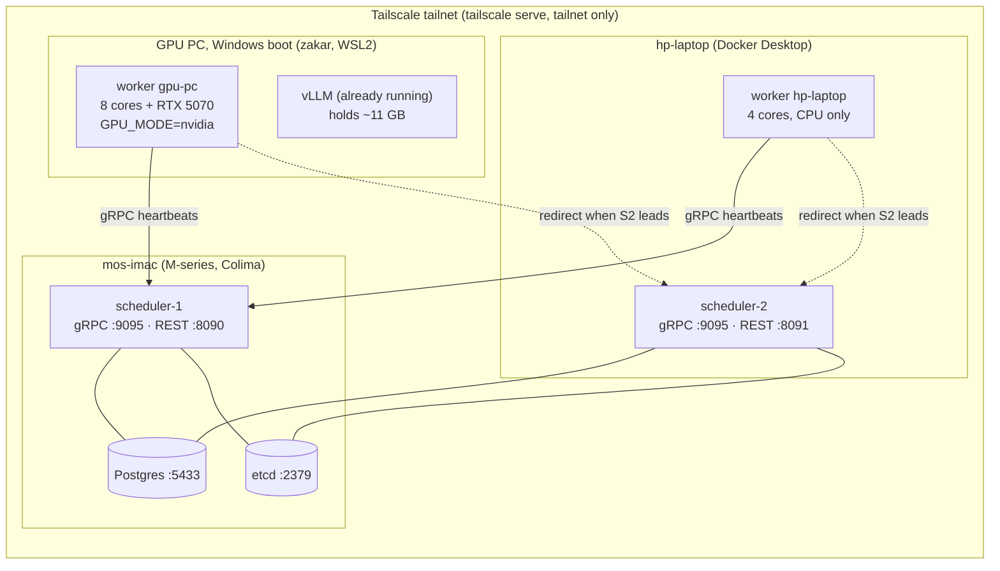

# Running GopherGrid across the homelab

**Status: running since 2026-11-13** on three machines of the
[homelab](https://github.com/zakiscoding/homelab) tailnet. The compose files are in
[`deploy/homelab/`](../deploy/homelab); the measurements are [below](#measured-on-the-homelab).

## Layout

Workers only make outbound gRPC calls to a scheduler. Nothing connects to them, so any machine
on the tailnet can join. Every port binds to `127.0.0.1` and is shared on the tailnet only with
`tailscale serve --tcp`, the same pattern the GPU PC already uses for vLLM. Nothing is reachable
from the LAN.



| Machine | Compose file | Runs | Notes |
|---|---|---|---|
| `mos-imac` | [`imac.yml`](../deploy/homelab/imac.yml) | Postgres, etcd, `scheduler-1` | arm64. Ports 9090/3000 are the homelab Prometheus/Grafana, so GopherGrid uses 9095/8090 |
| `hp-laptop` | [`laptop.yml`](../deploy/homelab/laptop.yml) | `scheduler-2`, worker `hp-laptop` | A second scheduler on another machine, so the cluster survives losing the iMac's scheduler |
| GPU PC (`zakar`, WSL2) | [`gpu-pc.yml`](../deploy/homelab/gpu-pc.yml) | worker `gpu-pc` | Real RTX 5070 from `nvidia-smi`; runs `container` jobs with `docker run --gpus device=<uuid>` |

The PC is in one boot at a time. On the Ubuntu boot (`zak-gpu-node`) the same `gpu-pc.yml`
works with the same `WORKER_ID`.

## Deploying it

```bash
# laptop: one shared secret, kept out of Git (deploy/homelab/.env is ignored)
printf 'POSTGRES_PASSWORD=%s\n' "$(openssl rand -hex 24)" > deploy/homelab/.env

# iMac (arm64). Its Docker has no BuildKit, so it can't run the Dockerfile itself. The build
# stage cross-compiles, so the laptop builds arm64 images natively and streams them over SSH.
tar -c --exclude=.git . | docker buildx build --platform linux/arm64 --target scheduler \
  -t gophergrid/scheduler:dev -o type=docker,dest=- - | ssh imac-ts docker load
ssh imac-ts 'cat > ~/1tb-drive/gophergrid/deploy/homelab/.env' < deploy/homelab/.env
ssh imac-ts 'cd ~/1tb-drive/gophergrid && docker-compose -p gophergrid \
  --env-file deploy/homelab/.env -f deploy/homelab/imac.yml up -d'
ssh imac-ts 'for p in 5433 2379 9095 8090; do tailscale serve --bg --tcp $p tcp://127.0.0.1:$p; done'

# GPU PC (amd64 worker image from the laptop)
docker save gophergrid/worker:dev | gzip | ssh zak-ts "wsl -d Ubuntu -- bash -c 'gunzip | docker load'"
ssh zak-ts "wsl -d Ubuntu -- bash -c 'cd ~/gophergrid && docker compose -f gpu-pc.yml up -d'"

# laptop
tailscale serve --bg --tcp 9095 tcp://127.0.0.1:9095
tailscale serve --bg --tcp 8091 tcp://127.0.0.1:8091
docker compose -p gophergrid-homelab --env-file deploy/homelab/.env -f deploy/homelab/laptop.yml up -d
```

(Over `ssh imac-ts`, Docker needs `DOCKER_HOST` pointing at the Colima socket on the external
drive, and Tailscale's CLI is `/Applications/Tailscale.app/Contents/MacOS/Tailscale`.)

Check it from any tailnet machine:

```bash
curl -s 100.91.113.98:8090/v1/leader
curl -s 100.91.113.98:8090/v1/workers
scripts/homelab-bench.sh -n 2000 -ms 0 -name my-run -reset   # ggbench against the iMac
```

`GPU_RESERVED_MB=11300`: vLLM keeps ~11.2 GB of the card's 12 GB, so the worker offers only
the remaining ~0.9 GB to jobs. Without it, placement would treat the whole card as free.

## Measured on the homelab

2026-11-13, raw JSON in [`bench/out/homelab-*`](../bench/out). Tailnet round trip 6–7 ms
between nodes; slots below are at 250 millicores per job (16 on the laptop, 32 on the GPU PC).

| Test | Result |
|---|---|
| Real GPU job: a `container` job running a PyTorch fp16 matmul in the vLLM image, needing 1 GPU and 600 MB | Placed by the iMac leader on `gpu-pc`'s RTX 5070 next to the live vLLM server: **41.4 TFLOPS fp16**, 9.4 s submit to result (mostly container start) |
| [Throughput](../bench/out/homelab-01-baseline.json): 2,000 zero-length jobs at 100 millicores | **1,620 jobs/s**, queue p50 567 ms; 1,321 ran on the GPU PC, 679 on the laptop; 0 duplicates |
| [Control](../bench/out/homelab-02-control.json): 3,000 × 200 ms jobs | 181 jobs/s, 0 retried, 0 duplicates |
| [Worker kills](../bench/out/homelab-03-chaos.json): same jobs, SIGKILL the laptop worker every 4 s, back after 6 s | 5 kills, 16 jobs retried, 3,000/3,000 succeeded, **0 duplicates**; 130 jobs/s, as the laptop's third of the slots was down most of the run |
| [Leader failover across machines](../bench/out/homelab-04-leader-failover.json): 600 × 1 s jobs, SIGKILL `scheduler-1` on the iMac with 360 queued | `scheduler-2` on the laptop elected **4.5 s** after the kill, first assignment 4.5 s; 600/600, 0 retried, **0 duplicates**, no worker declared dead |

The homelab throughput is higher than the single-laptop 1,269 jobs/s in
[RESULTS.md](RESULTS.md): Postgres and the leader run on the iMac's faster cores, and the
laptop no longer hosts every container.

## Things to know

- **Leases and timeouts use the Postgres clock**, so clock skew between machines doesn't
  matter for correctness.
- **The laptop sleeps.** If `scheduler-2` leads when it does, the iMac's scheduler takes over in
  ~5 s; its worker is declared dead after 3 s and its jobs move to the GPU PC.
- **The iMac is a single point of failure** for Postgres and etcd, as noted in DESIGN.md.
- **Monitoring:** the homelab's central Prometheus on the iMac scrapes both schedulers and both
  workers (worker metrics are shared on the tailnet as laptop `:9101` and GPU PC `:9102`), and
  [the dashboard](../deploy/grafana/dashboards/gophergrid.json) is public and read-only at
  https://grafana-proxy.vllm-gateway.workers.dev.
