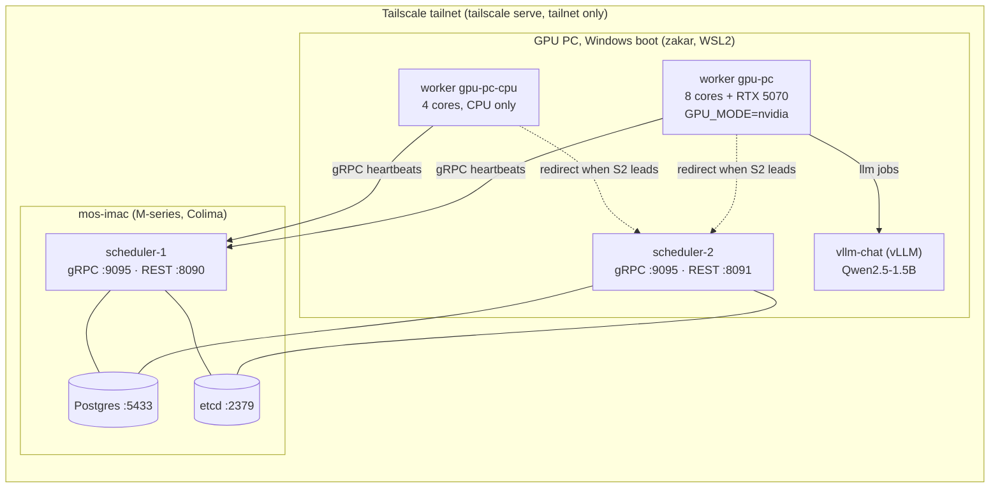

# Running GopherGrid across the homelab

**Status: running since 2026-11-13** on two machines of the
[homelab](https://github.com/zakiscoding/homelab) tailnet: the iMac and the GPU PC. Until
2026-11-14 `scheduler-2` and a CPU worker ran on the laptop, which is now only the controller
(it builds, deploys and runs the benchmark clients). The compose files are in
[`deploy/homelab/`](../deploy/homelab); the measurements are [below](#measured-on-the-homelab).

## Layout

Workers only make outbound gRPC calls to a scheduler. Nothing connects to them, so any machine
on the tailnet can join. Every port binds to `127.0.0.1` and is shared on the tailnet only with
`tailscale serve --tcp`, the same pattern the GPU PC already uses for vLLM. Nothing is reachable
from the LAN.



| Machine | Compose file | Runs | Notes |
|---|---|---|---|
| `mos-imac` | [`imac.yml`](../deploy/homelab/imac.yml) | Postgres, etcd, `scheduler-1` | arm64. Ports 9090/3000 are the homelab Prometheus/Grafana, so GopherGrid uses 9095/8090 |
| GPU PC (`zakar`, WSL2) | [`gpu-pc.yml`](../deploy/homelab/gpu-pc.yml) | `scheduler-2`; worker `gpu-pc-cpu` (4 cores, no GPU); worker `gpu-pc`: Go by default, or Rust with `WORKER_IMAGE=gophergrid/worker-rs:dev` | `scheduler-2` is on a different machine from `scheduler-1`, so the cluster survives losing the iMac's scheduler. `gpu-pc` reports the real RTX 5070 from `nvidia-smi`; runs `container` and `benchmark` jobs with `docker run --gpus device=<uuid>`, and `llm` jobs against `vllm-chat` over the serving network. `llm` and `benchmark` exist only in the Go worker, so since 2026-11-14 the GPU PC runs Go; the Rust worker ran here before that (see [worker-rs](../worker-rs)) |

The PC is in one boot at a time. On the Ubuntu boot (`zak-gpu-node`) the same `gpu-pc.yml`
works with `GPU_PC_TS_IP=100.121.51.35`, so `scheduler-2` advertises that address.

## Deploying it

```bash
# laptop: one shared secret, kept out of Git (deploy/homelab/.env is ignored)
printf 'POSTGRES_PASSWORD=%s\n' "$(openssl rand -hex 24)" > deploy/homelab/.env

# iMac (arm64). Its Docker has no BuildKit, so it can't run the Dockerfile itself. The build
# stage cross-compiles, so the laptop builds arm64 images natively and streams them over SSH.
tar -c --exclude=.git . | docker buildx build --platform linux/arm64 --target scheduler \
  -t gophergrid/scheduler:dev -o type=docker,dest=- - | ssh imac-ts docker load
ssh imac-ts 'cat > ~/1tb-drive/gophergrid/deploy/homelab/.env' < deploy/homelab/.env
ssh imac-ts 'cd ~/1tb-drive/gophergrid && docker-compose -p gophergrid \
  --env-file deploy/homelab/.env -f deploy/homelab/imac.yml up -d'
ssh imac-ts 'for p in 5433 2379 9095 8090; do tailscale serve --bg --tcp $p tcp://127.0.0.1:$p; done'

# GPU PC (amd64 images from the laptop). The remote shell is cmd.exe, so nothing below uses a
# pipe or redirect on the far side: stdin goes straight to docker load, dd or bash.
for i in scheduler worker; do docker save gophergrid/$i:dev | ssh zak-ts "wsl -d Ubuntu -u root -- docker load"; done
ssh zak-ts "wsl -d Ubuntu -u root -- dd of=/root/gophergrid/gpu-pc.yml status=none" < deploy/homelab/gpu-pc.yml
grep ^POSTGRES_PASSWORD= deploy/homelab/.env | ssh zak-ts "wsl -d Ubuntu -u root -- dd of=/root/gophergrid/.env status=none"
for p in 9095 8091 9102 9103; do ssh zak-ts "tailscale serve --bg --tcp $p tcp://127.0.0.1:$p"; done
echo 'cd /root/gophergrid && docker compose -p gophergrid -f gpu-pc.yml up -d' | ssh zak-ts "wsl -d Ubuntu -u root -- bash -s"
```

When `scheduler-2` leads, the GPU PC's own workers dial it at the PC's tailnet address. That
loops back through Windows Tailscale, which works from WSL containers.

(Over `ssh imac-ts`, Docker needs `DOCKER_HOST` pointing at the Colima socket on the external
drive, and Tailscale's CLI is `/Applications/Tailscale.app/Contents/MacOS/Tailscale`.)

Check it from any tailnet machine:

```bash
curl -s 100.91.113.98:8090/v1/leader
curl -s 100.91.113.98:8090/v1/workers
scripts/homelab-bench.sh -n 2000 -ms 0 -name my-run -reset   # ggbench against the iMac
```

`GPU_RESERVED_MB=11300`: vLLM keeps ~11.2 GB of the card's 12 GB, so the worker offers only
the remaining ~0.9 GB to jobs. Without it, placement would treat the whole card as free.

## Measured on the homelab

2026-11-13 and 14, raw JSON in [`bench/out/homelab-*`](../bench/out). Tailnet round trip 6–7 ms
between nodes. The 2026-11-13 runs (`homelab-01` to `-04`) predate the move off the laptop:
`scheduler-2` and a 4-core worker ran there, so those rows say "laptop" (slots at 250 millicores
per job: 16 on the laptop, 32 on the GPU PC).

| Test | Result |
|---|---|
| [`llm` jobs on the live vLLM](../bench/out/homelab-05-llm.json): 300 jobs × 8 prompts × 64 tokens, Qwen2.5-1.5B-Instruct on the RTX 5070 | **12.2 jobs/s, 5,792 completion tok/s**, request p50/p95 518/567 ms; 300/300, 0 retried. Same jobs again with the `gpu-pc` worker **SIGKILLed while running 6 of them**, back 5 s later: 300/300, 8 retried, 9.3 jobs/s, **0 duplicates** (600 jobs, 600 result rows) |
| [`benchmark` job, `matmul` suite](../bench/out/homelab-06-benchmark-matmul.json): gpu-systems-lab's `benchmarks/smoke_test.py`, 8192², 1 GPU and 900 MB requested, vLLM still serving | **63.6 TFLOPS fp16, 64.0 bf16**, 32.6 tf32, 22.9 fp32; 800 MiB peak, inside the 900 MB the job asked for; 15.5 s in the container |
| [`benchmark` jobs, `vllm-sweep` suite](../bench/out/homelab-07-inference-sweeps.json): FP16, AWQ and FP8 vLLM servers on the RTX 5070, each started, swept over concurrency 1–64 and stopped by the job ([submitter](../bench/submit_inference_sweeps.py)) | 3 configurations in 28 min of a chat-down window, ~6 min each; at 64 concurrent requests **FP8 5,735 tok/s vs FP16 4,211**. Results and charts are in [gpu-systems-lab](https://github.com/zakiscoding/gpu-systems-lab/blob/main/docs/RESULTS.md). AWQ needed 3 attempts: twice `gpu-pc` missed heartbeats for >3 s mid-run, was declared dead and its job requeued (see below) |
| [Speculative decoding sweeps](../bench/out/homelab-08-spec-decoding.json): off, n-gram and a 0.5B draft model, same job type, a second 23-minute window | Speculation was slower at every concurrency on this 1.5B model (n-grams 2% accepted, draft 27–30%); [write-up](https://github.com/zakiscoding/gpu-systems-lab/blob/main/docs/RESULTS.md). The first job lost its lease twice within 40 s of starting (again missed heartbeats); each retry removed the previous attempt's container first, and attempt 3 ran clean |
| Real GPU job: a `container` job running a PyTorch fp16 matmul in the vLLM image, needing 1 GPU and 600 MB | Placed by the iMac leader on `gpu-pc`'s RTX 5070 next to the live vLLM server: **41.4 TFLOPS fp16**, 9.4 s submit to result (mostly container start) |
| [Throughput](../bench/out/homelab-01-baseline.json): 2,000 zero-length jobs at 100 millicores | **1,620 jobs/s**, queue p50 567 ms; 1,321 ran on the GPU PC, 679 on the laptop; 0 duplicates |
| [Control](../bench/out/homelab-02-control.json): 3,000 × 200 ms jobs | 181 jobs/s, 0 retried, 0 duplicates |
| [Worker kills](../bench/out/homelab-03-chaos.json): same jobs, SIGKILL the laptop worker every 4 s, back after 6 s | 5 kills, 16 jobs retried, 3,000/3,000 succeeded, **0 duplicates**; 130 jobs/s, as the laptop's third of the slots was down most of the run |
| [Leader failover across machines](../bench/out/homelab-04-leader-failover.json): 600 × 1 s jobs, SIGKILL `scheduler-1` on the iMac with 360 queued | `scheduler-2` on the laptop elected **4.5 s** after the kill, first assignment 4.5 s; 600/600, 0 retried, **0 duplicates**, no worker declared dead |
| [Leader failover to the GPU PC](../bench/out/homelab-09-failover-to-gpu-pc.json) (2026-11-14, after the move): 600 × 1 s jobs, SIGKILL `scheduler-1` on the iMac with the jobs queued | `scheduler-2` on the GPU PC led **~5 s** after the kill (4.4–5.3 s by its log, 5.6 s seen from the laptop); 600/600, 0 retried, **0 duplicates**, both workers stayed alive; 32 s wall on 12 cores' worth of worker slots |

The homelab throughput is higher than the single-laptop 1,269 jobs/s in
[RESULTS.md](RESULTS.md): Postgres and the leader run on the iMac's faster cores, and the
laptop no longer hosts every container.

## Real work: `llm` and `benchmark` jobs

Two job types do real work on the GPU PC instead of simulating it. Only workers configured for
them advertise them, so placement sends them to `gpu-pc` and nowhere else.

| Type | Payload | What the worker does |
|---|---|---|
| `llm` | `{"prompts": [...], "max_tokens": 64}` | Chat completions against the live vLLM (`vllm-chat`, joined over its compose network), 8 in flight per job, greedy and seeded. The API key comes from the serving stack's `.env` and is never logged or returned. HTTP 4xx fails the job; 5xx, 429 and network errors retry |
| `benchmark` | `{"suite": "vllm-sweep", "label": "awq", "model": "Qwen/...", "quantization": "awq_marlin"}` or `{"suite": "matmul"}` | Runs a [gpu-systems-lab](https://github.com/zakiscoding/gpu-systems-lab) suite in the vLLM image on the assigned GPU. The payload names a suite and checked parameters, never a command |

**What "exactly once" means for real work.** A killed worker's `llm` requests *are* sent again,
because the work isn't idempotent at the server, and in the CI test the fake server saw 272
requests for 240 prompts. What GopherGrid guarantees is that each job records **one** result:
the lease-fenced attempt that won, with `outputs_digest` naming its text. It does not
guarantee that a retry writes the same text. With temperature 0 and a fixed seed, only 1,240
of 2,400 prompts (52%) gave identical completions across two runs on the live vLLM, because
batched kernels' numerics depend on what else is in the batch.

**Benchmarks and the GPU.** Each attempt writes to its own directory
(`BENCH_OUT_DIR/<job>/a<attempt>`), so a retry never mixes files with an earlier attempt, and
the recorded result names the directory of the winning attempt. Before starting, the worker
removes any container still labelled with the job, so an earlier attempt that lost its lease
can't keep holding the card. If the lease is lost mid-run, the worker removes the container
itself (killing the `docker` CLI alone would leave it running). A `vllm-sweep` needs the whole
card, so it only fits once `vllm-chat` is stopped and the worker restarts with
`GPU_RESERVED_MB=0`; until then placement leaves it queued.

Drivers: [`bench/llm_homelab.py`](../bench/llm_homelab.py) (the kill test above); benchmark
jobs are plain `POST /v1/jobs`.

## Things to know

- **Leases and timeouts use the Postgres clock**, so clock skew between machines doesn't
  matter for correctness.
- **The GPU PC reboots between Windows and Ubuntu.** While it is down, `scheduler-1` on the
  iMac leads (taking over in ~5 s if `scheduler-2` led), and no worker is up until the PC is back.
- **A worker declared dead can still be running.** During the AWQ sweep (and twice more at the
  start of the speculative-decoding sweep), `gpu-pc` missed heartbeats twice (cause not found; its logs went with a container recreate), so the leader
  requeued the benchmark and handed attempt 2 straight back to the same, re-registered worker.
  The old attempt still held the GPU, so the worker declined it, and the decline counted as a
  failed attempt. Now a worker reports a decline as `declined`, which requeues the job without
  using up an attempt (up to 3 times; `TestDeclineDoesNotUseAnAttempt`). The lost run still
  costs the GPU time it had used; reattaching a "dead" worker's live attempt would avoid that.
- **No retry backoff.** A failed attempt is retried at once: a job whose `llm` URL didn't
  resolve used all 5 attempts in 0.3 s. Backoff would be the next fix.
- **A Colima restart leaves GopherGrid down.** After `colima restart` on the iMac (2026-11-14),
  Postgres, etcd and `scheduler-1` stayed stopped despite `restart: unless-stopped`, and needed
  `docker start`. Check `/v1/leader` after any iMac VM restart.
- **The GPU PC's WSL clock ran 9–10 s behind** the iMac and laptop on 2026-11-14. Leases use the
  Postgres clock, so this only matters when lining up logs from different machines.
- **After `docker start` of `scheduler-1`, its gRPC port came back over the tailnet 15 s later
  once and ~90 s later another time** (REST on :8090 answered sooner). The workers kept retrying
  and re-registered by themselves; the cause wasn't found (likely Colima's port forwarding).
- **The iMac is a single point of failure** for Postgres and etcd, as noted in DESIGN.md.
- **Monitoring:** the homelab's central Prometheus on the iMac scrapes both schedulers and both
  workers (worker metrics are shared on the tailnet as GPU PC `:9102` for `gpu-pc` and `:9103`
  for `gpu-pc-cpu`), and
  [the dashboard](../deploy/grafana/dashboards/gophergrid.json) is public and read-only at
  https://grafana-proxy.vllm-gateway.workers.dev.
