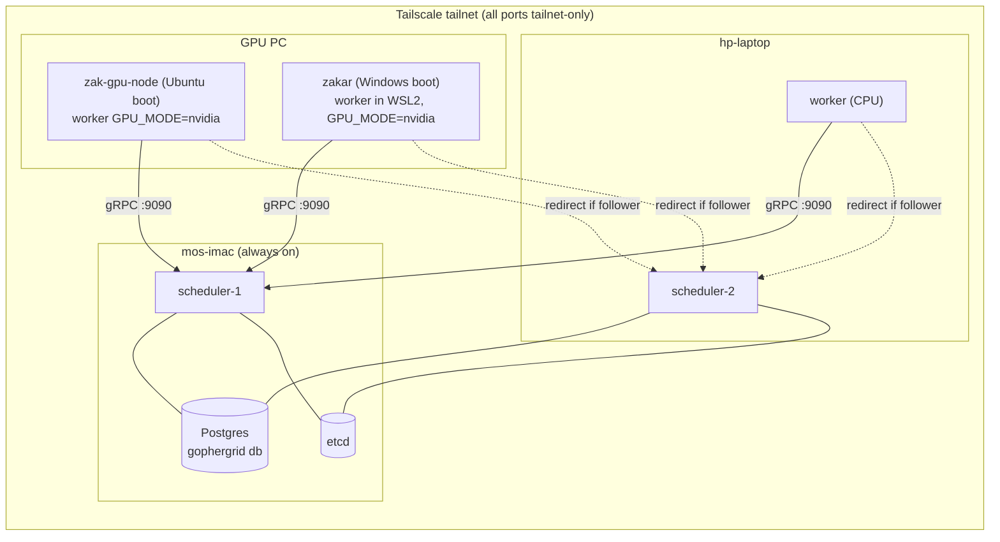

# Running GopherGrid across the homelab

**Status: a plan, not yet run.** Everything in [RESULTS.md](RESULTS.md) ran in Docker on one
laptop. This page shows how the same binaries map onto the homelab tailnet from
[gpu-systems-lab](https://github.com/zakiscoding/gpu-systems-lab) and what to watch out for.

## Why it fits

Workers only make outbound gRPC calls to a scheduler. Nothing connects to them. Any machine
that can reach a scheduler's Tailscale address can join: no port forwarding, and nothing
exposed beyond the tailnet. A worker reports its capacity, including real GPUs from
`nvidia-smi`, and the leader places work to fit.



| Machine | Runs | Why |
|---|---|---|
| `mos-imac` | Postgres (`gophergrid` database), etcd, `scheduler-1` | Always on, and already runs the homelab's Postgres and Grafana |
| `hp-laptop` | `scheduler-2`, a CPU worker | A second scheduler on another machine, so failover survives losing the iMac's scheduler process (not the iMac itself: Postgres and etcd live there) |
| GPU PC, Ubuntu boot (`zak-gpu-node`) | Worker with `GPU_MODE=nvidia` | The RTX 5070, reported by `nvidia-smi` |
| GPU PC, Windows boot (`zakar`) | The same worker inside WSL2 | WSL already runs Docker with GPU access for vLLM |

The PC is only ever in one boot, and whichever is up registers with the same `WORKER_ID`
(e.g. `gpu-pc`). After a reboot that took longer than the heartbeat timeout, the worker is
declared dead, its jobs move elsewhere, and it simply registers again when it comes back.

## Configuration

Control plane on the iMac (Postgres and etcd ports bound to its Tailscale IP only):

```bash
# scheduler-1, on mos-imac
DATABASE_URL=postgres://gophergrid:<password>@127.0.0.1:5432/gophergrid?sslmode=disable
ETCD_ENDPOINTS=127.0.0.1:2379
ADVERTISE_ADDR=100.91.113.98:9090     # what workers dial; mos-imac's tailnet IP
GRPC_ADDR=100.91.113.98:9090          # listen on the tailnet only
HTTP_ADDR=100.91.113.98:8080
```

`scheduler-2` on the laptop uses the same `DATABASE_URL` and `ETCD_ENDPOINTS` pointed at the
iMac's tailnet IP, and advertises the laptop's own tailnet address. Keep the password in an
`.env` that stays out of Git, as the other homelab repos do.

A GPU worker on the PC:

```bash
docker run -d --name gophergrid-worker --restart unless-stopped --gpus all \
  -e WORKER_ID=gpu-pc \
  -e SCHEDULER_ADDRS=100.91.113.98:9090,<laptop-tailnet-ip>:9090 \
  -e GPU_MODE=nvidia \
  -e GPU_RESERVED_MB=8500 \
  -e CPU_MILLIS=8000 -e MEMORY_MB=16384 \
  -e ENABLE_CONTAINERS=true -v /var/run/docker.sock:/var/run/docker.sock \
  gophergrid/worker:dev
```

- `GPU_RESERVED_MB`: vLLM keeps ~8.2 GB of the card's 12 GB, so only the rest is offered to
  jobs. Without it, placement would treat the whole card as free.
- `ENABLE_CONTAINERS`: lets the worker run `container` jobs with `docker run --gpus device=<uuid>`,
  using the GPU the scheduler picked, and hard `--cpus`/`--memory` limits.
- On the Windows boot, the keep-alive task and `.wslconfig` from gpu-systems-lab already keep
  WSL up, so a worker container there stays up too.

## Things to check when it first runs

- **Clock-sensitive bits:** leases and heartbeat timeouts use the Postgres server's clock, so
  worker clock skew doesn't matter. The metrics do assume the schedulers' clocks are roughly
  in sync.
- **Latency:** heartbeats over Tailscale on Wi-Fi will be slower than the local Docker numbers.
  Raise `HEARTBEAT_TIMEOUT` (3 s) if workers get declared dead during brief Wi-Fi drops.
- **The iMac is a single point of failure** for Postgres and etcd. That's acceptable for a lab,
  and the same limit noted in DESIGN.md.
- **Monitoring:** add the schedulers as a Prometheus target in the iMac's existing stack and
  import [the dashboard](../deploy/grafana/dashboards/gophergrid.json).
